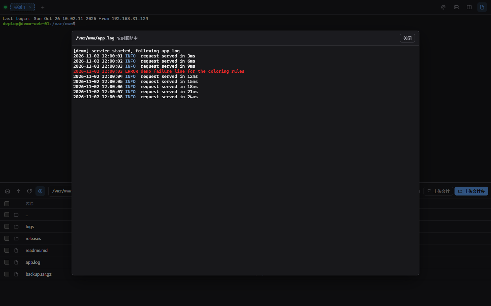
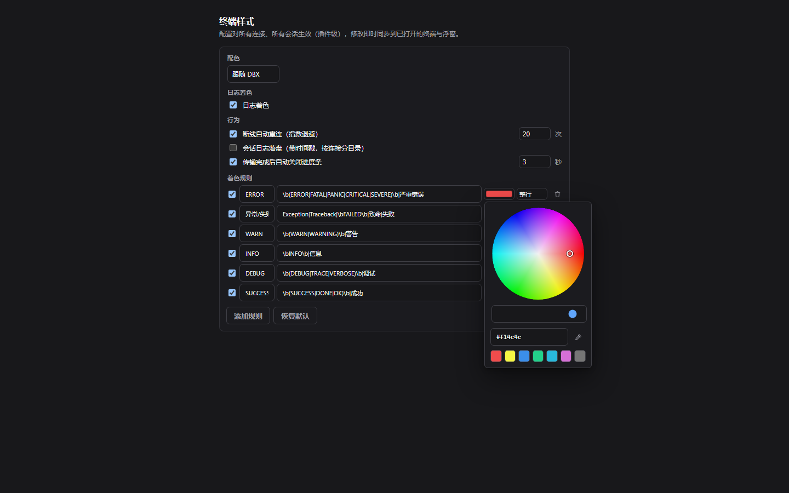

# TermHive（蜂巢终端）

[](https://github.com/Miliiiiiiiii/TermHive/actions/workflows/ci.yml)
[](https://github.com/Miliiiiiiiii/TermHive/actions/workflows/plugin-release.yml)
[](https://github.com/Miliiiiiiiii/TermHive/releases)

DBX 插件：SSH 终端 + SFTP 文件管理。连接保存在 DBX 原生连接列表里，双击连接即在 DBX 标签页内打开终端与文件面板。插件 id 为 `com.milii.termhive`（发布者 milii）。

## 截图

> 预览模式（mock 数据）下截取，实际界面一致。

| 会话（终端 + 文件面板 + 日志跟随） | 设置（配色 / 着色规则 / 行为开关） |
|---|---|
|  |  |

## 功能

- **原生连接体系**：连接走 DBX connection-provider（密码/私钥/键盘交互认证、认证方式智能回退、用户名密码防呆校验、keepalive、GBK/GB18030 编码、登录后执行命令），凭据由 DBX secret-store 保管
- **服务器指纹校验（TOFU）**：首次连接自动记录服务器主机密钥指纹（SHA256，存 `known_hosts.json`）；指纹变更时拒绝连接并给出中文告警与重置方法
- **多会话与分组**：同一连接可开任意多个终端会话，全部复用一条 SSH 连接；标签名持久（删除中间标签不影响其他标签名）、双击可重命名；**会话分组**——把一个标签拖到另一个标签上即成组（或右键菜单分组），**组在标签条上是一个带名字的单元**（组名可改、可解散），组内成员自动并排分栏（最多 4 栏：2/3 纵排、4 栏 2×2），点组内任一标签整组上屏；把标签拖出组即移出；跨服务器的会话也能进同一组
- **每栏标题栏**：分栏时每栏自带名称（会话名、跨服务器徽标、双击改名、× 移出分组）
- **插件设置页**：配置在独立的"DBX Shell 设置"标签页（首页右上角调色板进入）——终端配色主题（One Dark / Dracula / Solarized Dark / Nord / GitHub Light / 跟随 DBX）与**日志着色规则**（ERROR 红 / WARN 黄 / INFO 蓝 / DEBUG 灰 / 异常红 / 成功绿，正则+7 色+整行/片段完全自定义）；**插件级生效**：修改实时广播到所有已打开的终端与浮窗，重启保留
- **SFTP 文件面板**：浏览 / 上传 / 下载 / 重命名 / 删除 / 新建文件夹；多选批量下载（zip 流式打包，边打包边下载）；拖拽上传；文件面板跟随终端 cwd（可开关）
- **日志模式**：文件面板对日志文件一键跟随（tail -f），xterm 渲染并与日志着色规则联动；滚动锁定——上翻暂停跟随并提示新输出行数，回底自动恢复；Ctrl+F 搜索；轮转/截断自动重置跟随
- **断线自动重连**：连接断开后监督者按指数退避（2s→60s）自动重拨，可关；认证失败与主机指纹变更视为永久失败不硬试；重连成功标签页自动重绑
- **会话日志落盘**：可选把终端输出带时间戳写入 `<dataDir>/logs/<user@host_port>/`（按连接分目录、按会话分文件），设置页开关实时挂载/摘除
- **AI 工具（MCP）**：12 个工具三档对外授权（只读 / 写 / full）——白名单只读命令分类器（按 shell 家族词法判定）、只读日志跟随三件套 `tail_start/tail_read/tail_stop`（服务端拼装命令、连接即作用域、空闲自动回收）、灾难模式硬拒、写操作逐次弹窗批准、调用进 diag.log 与 DBX 审计
- **传输性能**：大文件下载走并发分块读（严格按序重组），下载缓冲内存池化；SFTP 通道断线自愈重建
- **终端体验**：xterm.js WebGL GPU 渲染（自动降级）；Ctrl+F 悬浮搜索栏；链接可点击；输出微批合帧（高吞吐刷屏更顺）；4ms 内交互零感知
- **凭据安全落盘**：重连凭据缓存以密封信封落盘（Windows DPAPI / 其他平台 AES-256-GCM），明文只存在于内存——重启后仍可独立重拨
- **浮窗小屏**：桌面端可把会话拉出为置顶迷你终端（`floating` API，每个贡献点一个窗口）
- **断线恢复**：断线显示"重新连接"（或自动重连中）；历史输出环形缓冲（128KB）attach 回放
- **可诊断**：飞行记录仪把 UI↔后端全量调用写 `<dataDir>/diag.log`（自动脱敏、封顶 128KiB）

## 架构

```
ui/dist/index.html        单文件沙箱 UI（Vite + TypeScript + xterm.js）
backend/                  Go sidecar（x/crypto/ssh + pkg/sftp）
  main.go                 JSON-RPC 方法分发
  connection.go           连接生命周期（connect/ensure/credentials/认证策略）
  conn.go                 共享 SSH 连接（keepalive / SFTP / cwd 探测）
  shell.go                PTY 会话（编码 / 环形缓冲 / 回放 / 会话日志挂钩）
  manager.go              连接注册表 + 传输引擎（ack 流控）
  mcp.go + mcptail.go     AI 工具（只读分类器 / 跟随任务）
  tailfollow.go           日志模式 follower（SFTP 轮询推送）
  reconnect.go            断线自动重连监督者（指数退避）
  sessionlog.go           会话日志落盘（带时间戳，按连接分目录）
  hostkey.go              服务器指纹库（TOFU known_hosts）
  secrets*.go             凭据密封（DPAPI / AES-GCM）
  fs.go / editor.go       RemoteFS 抽象 / 远程编辑器
manifest.json             stdio-framed 传输，权限 host.workbench/binary/events/ai
scripts/                  proto-test / e2e-test（内嵌 SSH+SFTP 测试服务器）/ build-ui
tools/testsrv/            仅测试用的本地 SSH+SFTP 服务器
docs/ROADMAP.md           功能发展报告与路线图
```

通信：UI 通过 Host Bridge `invoke` 调 sidecar 方法，终端与传输走 `term/<id>`、`up/<id>`、`down/<id>`、`tail/<id>` 二进制通道；sidecar 通过 `shell.closed` / `transfer.*` / `connection.*` / `tail.done` 事件回报状态。

## 开发

前置：Node 22+、Go 1.22+、DBX ≥ 0.5.68。

```bash
npm install && npm --prefix ui install                      # 首次（根 + ui 两套依赖）
cd backend && go build -o bin/dbx-plugin-termhive.exe .    # 构建后端
cd backend && go test ./...                                 # Go 单元测试
npm run test                                                # 协议 + e2e（内嵌 SSH+SFTP 测试服务器）
npm run preview                                             # 无宿主 UI 预览（模拟桥， http://127.0.0.1:5390）
dbx-plugin dev --path . --port 5190                         # 浏览器开发宿主
dbx-plugin package .                                        # 产出 dist/*.dbxp
```

无宿主预览：`?view=session` 直接看会话页，默认打开首页；`ui/src/mock.ts` 提供模拟桥。

浏览器开发宿主注意事项：

- 宿主不给 sidecar 设置 `DBX_PLUGIN_DATA_DIR`，回退到 `<项目>/.dbx-dev/plugin-data`
- 宿主按 (session, page, contribution) 复用工作台帧：同一来源重复 `openWorkbench` 会以 context 更新复用同一帧，UI 端已用 `onContext` 重路由兼容
- 沙箱屏蔽原生 `alert/confirm/prompt`，一律使用自绘组件
- `floating` / `fileTransfer` 为桌面宿主专属，UI 已做特性检测降级

## 安装

`dist/com.milii.termhive-<version>-<target>.dbxp` 为未签名候选包：在 DBX 插件中心开启开发者安装后选择该文件。发布到 DBX Store 需走 `t8y2/dbx-store` 签名流程（见 `.github/workflows/plugin-release.yml`）。

## 文档

- [CHANGELOG.md](CHANGELOG.md) — 每个发布版本的变更记录
- [docs/ROADMAP.md](docs/ROADMAP.md) — 功能发展报告与路线图
- [docs/VERSIONING.md](docs/VERSIONING.md) — 版本管理与发布流程

## English

TermHive is a DBX plugin: an SSH terminal and an SFTP file panel living natively in DBX tabs. Connections are stored in DBX's own connection list — double-click one and the terminal plus file panel open inside a DBX workbench.

Highlights:

- **Native connection system** — DBX connection-provider with password/key/keyboard-interactive auth, smart fallback, keepalive and GBK/GB18030 transcoding; credentials sealed at rest (DPAPI / AES-256-GCM)
- **Server fingerprints (TOFU)** — SHA256 host-key pinning with an explicit alarm on change
- **Multi-session & grouping** — any number of terminals per connection over one SSH transport; drag-to-group with automatic side-by-side panes (up to 4)
- **SFTP file panel** — browse/upload/download/rename/delete, multi-select zip download, drag-drop upload, follow-terminal-cwd
- **Log mode** — one-click `tail -f` on any log file rendered in xterm with the coloring rules, scroll-lock (pause on scroll-up, resume at bottom) and Ctrl+F search; rotation-safe
- **Auto-reconnect** — exponential backoff (2s→60s), off-switch in settings; auth failures and host-key changes are treated as permanent
- **Session logging** — optional timestamped terminal transcripts under `<dataDir>/logs/<user@host_port>/`
- **AI tools (MCP)** — 12 tools with three-tier exposure: a whitelist-based read-only command classifier, read-only log-follow tasks (`tail_start`/`tail_read`/`tail_stop`), catastrophic-pattern hard refusal and per-call approval for writes
- **Terminal feel** — xterm.js WebGL rendering, floating mini terminal, 128KB reconnect replay buffer

## License

[MIT](LICENSE)
